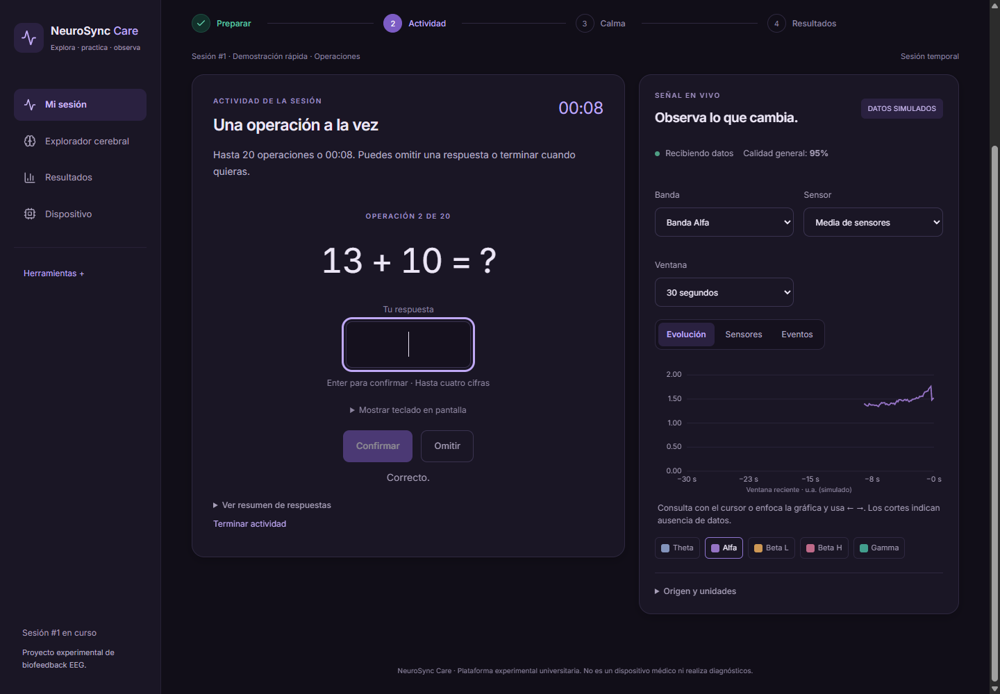
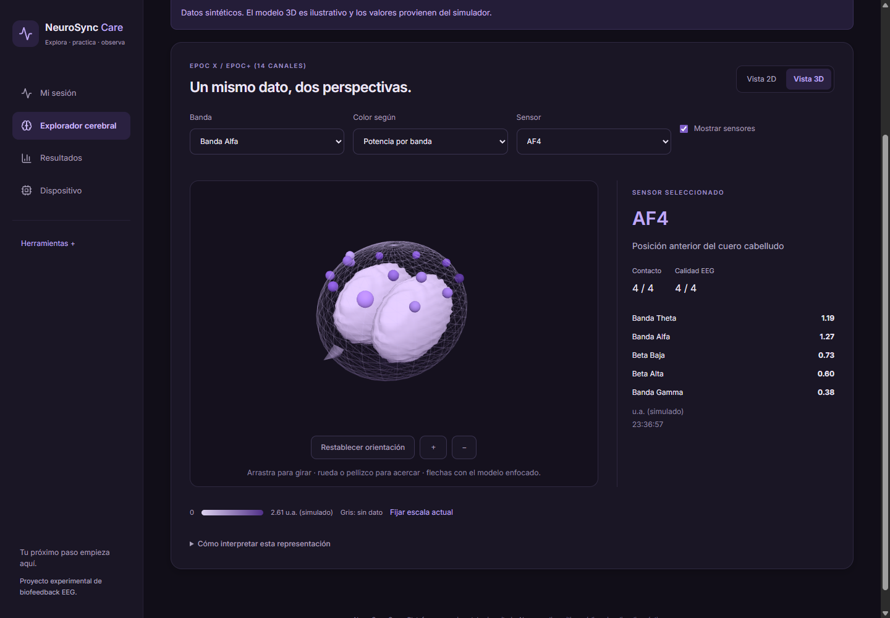
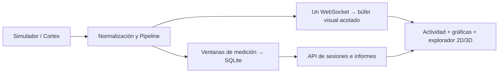

# NeuroSync Care

Laboratorio interactivo local para visualizar indicadores EEG durante actividades cognitivas y ejercicios de autorregulación. Proyecto universitario de Biomedicina e Ingeniería de Software en Ecuador.

**Preparar → Actividad → Calma → Resultados.** El recorrido original se conserva. Puedes practicar operaciones o explorar el piloto de lectura de código, observar potencia por bandas y consultar un informe descriptivo.



## Qué incluye

- Simulador sin hardware, reproducible y claramente identificado.
- Adaptador EMOTIV Cortex para potencia, calidad EEG y estado/contacto.
- Gráficas con banda, sensor, ventana temporal, leyenda y lectura por instante, sin rellenar huecos.
- Explorador 2D y 3D con el mismo inspector; giro, zoom, selección y alternativa 2D sin WebGL.
- Preparación EMOTIV por modelo dentro de una nueva sesión, con calidad recibida y revisiones manuales diferenciadas.
- Matemáticas acotadas y guías de calma 4–6, 4–4 o atención al entorno.
- Piloto NeuroCode: comprensión/detección de errores mediante opciones, sin ejecutar código del participante.
- Informes, historial autorizado, CSV e impresión. Tema claro y oscuro.



El mapa muestra sensores sobre posiciones aproximadas del cuero cabelludo. La geometría interior es ilustrativa; no es anatomía individual ni localización de actividad cortical. NeuroSync Care no realiza diagnósticos ni convierte bandas EEG en porcentajes clínicos de estrés.

## Tecnologías y arquitectura

| Capa | Tecnología |
| --- | --- |
| Backend local | Python, FastAPI, SQLAlchemy ORM, SQLite |
| Señal y análisis | Simulador / Cortex, NumPy, Pandas |
| Interfaz | React 18, TypeScript, Vite, Tailwind y SVG |
| Vista 3D opcional | Three.js, geometría propia cargada bajo demanda |
| Pruebas | pytest, node:test y recorrido Chrome/Edge aislado |



## Instalación en Windows PowerShell

Requisitos: Python 3.11/3.12 y Node.js con npm (comprobado con Python 3.12 y Node 24). Internet para instalar dependencias; el simulador no necesita credenciales ni licencia EMOTIV. Si utilizas un gestor de Node, activa una versión instalada antes de ejecutar npm.

Desde la raíz del repositorio:

```powershell
cd backend
python -m venv .venv
.\.venv\Scripts\python.exe -m pip install -r requirements.txt
```

En otra terminal desde la raíz:

```powershell
cd frontend
npm ci
```

No copies entornos .venv o node_modules de otro equipo. Cada integrante debe instalarlos localmente.

## Ejecutar

Terminal 1, desde la raíz:

```powershell
cd backend
.\.venv\Scripts\python.exe -m uvicorn app.main:app --host 127.0.0.1 --port 8000 --reload
```

Terminal 2, desde la raíz:

```powershell
cd frontend
npm run dev
```

Abre http://localhost:5173. API: http://127.0.0.1:8000/docs. Estado: http://127.0.0.1:8000/api/health.

Si PowerShell bloquea npm.ps1, utiliza npm.cmd con los mismos argumentos. Si solo se abre el frontend, la simulación no funcionará: también necesita el backend.

Para probar: Nueva sesión → Simulador → elegir actividad → Comenzar. La demostración rápida está en Opciones de demostración. Para equipo real, consulta [EMOTIV_SETUP](docs/EMOTIV_SETUP.md). Los secretos se configuran en backend/.env y no se publican.

## Comprobar

```powershell
cd backend
.\.venv\Scripts\python.exe -m pytest -q
```

```powershell
cd frontend
npm test
npm run build
```

Con Chrome o Edge instalado, desde la raíz:

```powershell
.\backend\.venv\Scripts\python.exe scripts/test_browser.py
```

La prueba de navegador usa procesos, puertos y SQLite aislados. [Cobertura y resultados](docs/TESTING.md).

## Datos, compatibilidad y límites

Las bases existentes no se recrean. Al iniciar se añaden las columnas/tablas necesarias para NeuroCode; las sesiones anteriores se conservan como MATH. Guarda una copia de tu SQLite, con el backend detenido, antes de actualizar un equipo con datos de investigación.

El guardado en historial empieza desmarcado. Las sesiones temporales también usan SQLite, quedan fuera del historial y se descartan al salir de Resultados o al reiniciar el backend. Cerrar la pestaña sin conexión puede dejar esos datos hasta el siguiente arranque. Los CSV descargados son copias independientes.

La API está pensada para un único proceso local y una sesión activa, sin autenticación multiusuario. El EEG crudo y las métricas afectivas no se solicitan. La integración física y los protocolos de investigación requieren validación con el equipo universitario.

Los patrones del simulador son ficticios. Las estadísticas describen ventanas agregadas, no los extremos ni la desviación de muestras EEG originales. No se deducen causalidad, emociones ni competencia personal.

## Documentación

Empieza por el [índice](docs/INDEX.md): guía de usuario, preparación EMOTIV, arquitectura, protocolo, piloto NeuroCode, limitaciones, pruebas y cambios de esta intervención.
