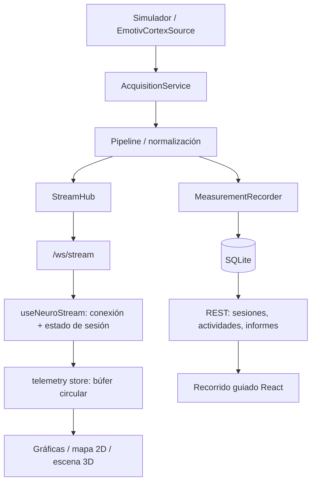

# Arquitectura y contratos

## Límites del sistema

Aplicación modular local, un único worker y una sesión activa. Se mantienen FastAPI, React 18, SQLite, el simulador y el adaptador Cortex. No hay microservicios, ejecutor de código arbitrario ni clasificador clínico.

## Backend

- acquisition/: adaptadores, geometrías aproximadas y normalización Cortex. No cambia la lista autorizada de flujos: pow, eq, dev.
- services/: adquisición, pipeline, registro, hub, sesiones, operaciones, piloto de código e informes.
- repositories/, models/, schemas/: consultas, modelos SQLAlchemy ORM y contratos Pydantic.
- analytics/: estadísticas descriptivas sobre ventanas existentes, sin rellenar huecos.
- database/migrations.py: cambios aditivos e idempotentes.

El registrador conserva la agregación de un segundo por fuente/flujo/sensor/métrica/fase, incluidos conteos válidos y ausentes. La visualización no altera esta política ni reduce muestras almacenadas.

StreamHub copia el mensaje antes de encolarlo y entrega en el loop propietario incluso cuando publica un endpoint síncrono desde otro hilo. Sus colas siguen acotadas; un cliente lento no detiene la adquisición. La desconexión de un cliente limpia y espera sus tareas WebSocket.

MeasurementRecorder serializa cambios de ventanas y solo las retira tras confirmar el commit. Un fallo de escritura conserva ventanas para reintentar. SessionService serializa inicios, fases y cierres dentro del proceso. Esto no habilita concurrencia multiworker ni sustituye autenticación/aislamiento por usuario.

## Frontend

| Área | Responsabilidad |
| --- | --- |
| App, useNeuroStream | Una conexión, estado de fuente/sesión, navegación y recuperación |
| features/session | Progreso guiado, preparación por modelo y comprobaciones manuales/software |
| features/telemetry | Búfer circular, snapshot visual, filtros y curva con huecos |
| features/neuromap | Modelo de sensores compartido, inspector, vista 2D y escena 3D |
| features/neurocode | Tarea controlada de lectura de código |
| components/charts | Gráficas de informes existentes |
| services/api, config | Cliente HTTP y URL base/WebSocket centralizadas |

El store recibe todos los fotogramas y conserva hasta 1024. Agrupa notificaciones de interfaz hasta una cada 125 ms. App no se actualiza por cada frame: las vistas de señal se suscriben mediante useSyncExternalStore. El registro científico sigue en el backend.

La historia incluye todas las bandas y sensores del frame, unidad y fuente. Los huecos se conservan. Un cambio de origen limpia el búfer; una pérdida de señal añade un corte sin mantener un valor como si siguiera midiéndose.

El recorrido de sesión permanece montado al navegar. Esto conserva preguntas, técnica y pausa local de la guía, y permite cerrar la referencia aunque se consulte el explorador. Los relojes de referencia, matemáticas y código usan started_at/planned_duration_s del servidor. Una recarga recupera las fases y respuestas persistidas, pero no la pausa local de calma.

## Una sola definición de actividades

GET /api/protocol conserva phases y math y añade activities. El registro de actividades contiene MATH y CODING, su fase, momento de autoevaluación y duraciones. MATH sigue siendo el valor predeterminado para clientes anteriores.

CODING es una extensión aditiva. El piloto vincula una tarea del catálogo a Phase.detail y comprueba tipo de fase, plazo, límites de intento y corrección en el servidor. No registra teclas ni contenido externo.

| Contrato NeuroCode | Contenido |
| --- | --- |
| SessionCreate / SessionOut | `activity_kind`: MATH por defecto o CODING |
| PhaseKind / ReportMoment | Valores aditivos CODING y POST_CODING |
| GET /api/coding/tasks | Catálogo versionado sin respuestas esperadas |
| POST /api/coding/answers | `session_id`, `task_id`, `choice`; exige fase, tarea, plazo e intento válidos |
| SessionDetail / SessionSummary | `coding_answers` / `coding` con intentos y desempeño |
| CSV | `dataset=coding`; `effort` añadido al final de autoevaluaciones |

Los instantes de inicio y fin siguen en session_phases. Los siete momentos del protocolo habitual se presentan como cuatro pasos de usuario. La finalización guiada produce COMPLETED; detener produce ABORTED. Terminar una fase no garantiza que se resolviera su tarea.

No existe un planificador de cierre de fases tras abandonar completamente el navegador. El servidor rechaza respuestas matemáticas/de código fuera de plazo; al reiniciar cierra sesiones huérfanas y purga temporales conforme a la política existente.

## 2D y 3D

sensorModel.ts deriva valor original, contacto, calidad y color. Ambas vistas utilizan ese mismo objeto y mantienen la selección al alternar. El inspector es común.

Las coordenadas 2D del backend se aproximan a una superficie superior elipsoidal: X derecha del participante, Y superior, Z frontal. Las dos formas internas con pliegues son geometría procedimental propia. No es localización de fuentes ni un modelo anatómico individual.

Three.js 0.187.0 y OrbitControls se cargan únicamente al pedir 3D. No se descargan modelos o texturas externos. Se limita la densidad de píxel, se dibuja por cambios y se liberan geometrías, materiales, controles, observador y contexto al desmontar. WebGL no disponible o perdido retorna a 2D.

El bundle 3D es independiente y ronda 138 kB gzip en esta implementación. El build advierte que ese chunk supera 500 kB sin comprimir; no forma parte de la carga inicial. En equipos modestos se puede usar 2D.

## Compatibilidad y migración

Se preservan los endpoints existentes y los tipos de mensajes hello, frame, status, session. Se añaden endpoints coding/tasks y coding/answers; no se modifica la estructura de frames Cortex para el 3D.

Cambios de SQLite:
- sessions.activity_kind: valor MATH para filas anteriores.
- self_reports.effort: columna nullable.
- coding_answers: tabla nueva con FK a sesión/fase e índice único de intento por fase.

create_all crea tablas ausentes; la migración inspecciona columnas y añade solo las faltantes. Ejecutarla dos veces no duplica columnas ni borra registros. La prueba legacy inserta filas con el esquema anterior y comprueba su conservación.

La reversión de Git no elimina estas columnas ni las tareas nuevas. Una versión antigua no interpreta CODING: conserva copia de la base previa si necesitas volver al software anterior. No se ejecutan migraciones destructivas de downgrade.

La interpretación del registro, privacidad y límites estadísticos se documenta exclusivamente en [Investigación](RESEARCH.md). El procedimiento y los detalles de Cortex están en [Conexión EMOTIV](EMOTIV_SETUP.md).
